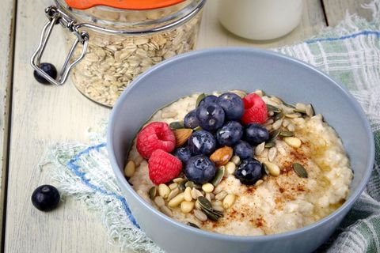
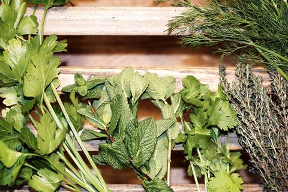

# Articles

## [Give your oatmeal the ultimate makeover](/articles/give-your-oatmeal-the-ultimate-makeover)

It is vegan, gluten-free, low in fat, high in fiber, and can even lower cholesterol - but oatmeal is boring, right? Well, before you write off that boring jar of oats, you might want to take…

## [Skip the spirits with delicious mocktails - says Dashka](/articles/skip-the-spirits-with-delicious-mocktails)

Having a cocktail party? Then why not serve up something just as special for those who don't drink alcohol but do want to join in on all the fun? After all, what cocktail party is complete without…

## [Let's hear it for carrots](/articles/lets-hear-it-for-carrots)

Let's hear it for the humble carrot! This sweet and healthy ‘everyday’ veg packs it all in. Great flavor, fantastic color, and if you're one for believing the old story, they can even help you to see…

## [Give it a go and grow your own herbs](/articles/give-it-a-go-and-grow-your-own-herbs)

There's nothing like having your own supply of fresh herbs, readily available and close at hand to use while cooking. Whether you have a large garden or a small kitchen window sill, there's always…
