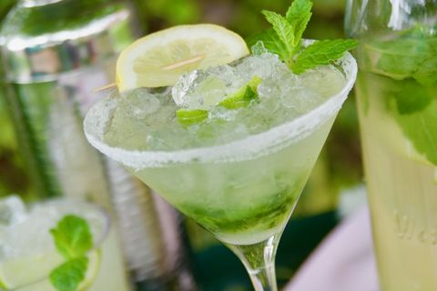

# Skip the spirits with delicious mocktails - says Dashka

Having a cocktail party? Then why not serve up something just as special for those who don't drink alcohol but do want to join in on all the fun? After all, what cocktail party is complete without those incredible looking glasses of mixed fruits, bright colors and of course, the little umbrellas?

So, grab the cocktail mixer, skip the spirits, and shake up these deliciously refreshing mocktails that won't leave you or your guests, short on flavor or style.

## Mango-licious

This delicious drink has a sophisticated taste that is ideal for adults and the color is perfect for a late summer BBQ.

### Instructions:

Give a few slices of cucumber and a little honey a good shake in a cocktail shaker. Add a spirit measure of mango puree and the juice of one lime. Add some ice and shake for all you're worth. Using a strainer, pour into a fancy glass and top with ginger beer.

## Mocky Mojito

There's nothing quite like a Mojito on a warm day and this version is ideal for a relaxing end of the day moment of bliss in the garden.

### Instructions:

Muddle sugar, a squeeze of lime, and mint leaves in a tall glass, then add a few chunks of ice, top with the juice of a blood orange (for the sunset effect), and add a splash of soda water.
