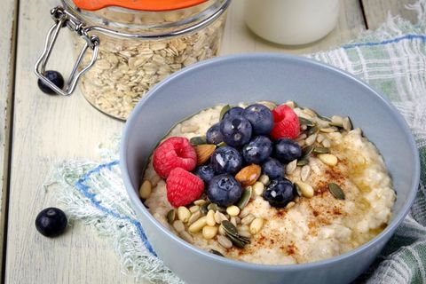
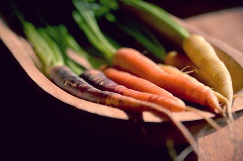

# Artículos

## [Dale a tu avena el cambio de imagen definitivo](/es/articles)

Es vegano, libre de gluten, bajo en grasa, alto en fibra e incluso puede reducir el colesterol, pero la harina de avena es aburrida, ¿verdad? Pero, antes de descartar ese aburrido jarrón de avena, es…

## [Un aplauso para las zanahorias](/es/articles)

¡Un aplauso para la humilde zanahoria! Esta verdura dulce y saludable lo tiene todo.
